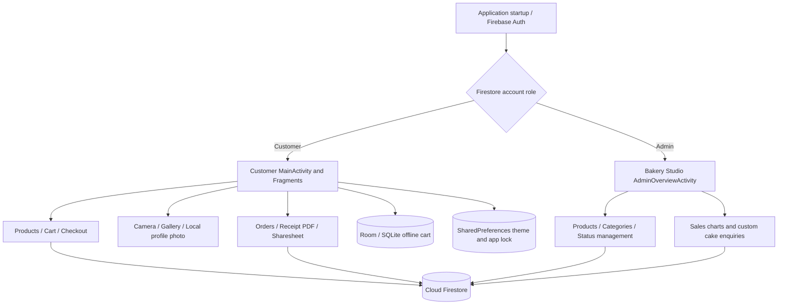

# Butter Queen Cakes — Technical Report Draft

**Project:** Butter Queen Cakes (Android customer app + Bakery Studio admin interface)  
**Platform:** Android / Java  
**Android package:** `lk.jiat.butterqueen`  
**Author:** [Enter student name and registration number]  
**Module and university:** [Enter module/course details]  
**Submission date:** [Enter date]  

> This is a **draft for the student's own report**, not a fabricated final assessment. Add actual app screenshots, architecture images, test measurements, personal design rationale, supervisor feedback and citations. Validate the statements below against the installed APK before submission.

## 1. Abstract

Butter Queen Cakes is a Java Android application for purchasing bakery products, including cakes sold by weight and cupcakes/brownies sold by pieces. It provides a customer shopping experience (catalog, cart, checkout, order tracking, and receipt PDFs) and a separate administrator interface called Bakery Studio. Administrators can maintain products, categories, review custom cake enquiries, change order statuses, and view charts based on actual orders. Firebase Authentication and Cloud Firestore manage user identity and shared operational data. Room supplies a local SQLite cart snapshot for offline reading. Local app-private files store profile photographs captured with the camera or selected from the gallery. Google Maps shows defined delivery areas. The application includes device features such as an accelerometer gesture, network/battery event handling, notification intents, a biometric/password app lock, and saved theme preferences.

## 2. Problem statement and objectives

Customers need a straightforward, mobile-friendly way to browse cakes, understand whether prices are per kilogram or per piece, request personalized cakes, select delivery details, and follow orders. Bakery staff need a fast operational overview instead of the customer interface.

Objectives:
1. Build clear, accessible customer and admin navigation with separate role-based home screens.
2. Support a unit-aware catalog, quantities, shopping cart, checkout, and receipts.
3. Store and retrieve cloud order/product data with Firestore rules that distinguish customers and admins.
4. Demonstrate native Android abilities (camera/gallery, local storage, maps, notifications, sensors, system intents, preferences and data sharing).
5. Handle offline scenarios gracefully, especially for a previously loaded cart.
6. Summarize operational data in charts and allow authorized order-status management.

## 3. Scope and boundaries

**Included:** email/password sign-in, role-based routing, categories/products, kilogram/piece pricing, wishlist, search, custom cake enquiry, cart, Cash on Delivery, PayHere **sandbox**, order history/status, current receipt/PDF, locally stored profile photographs, light/dark/system theme, app lock, analytics, Google Map delivery boundaries, call/email support, and Android Sharesheet transfer.

**Not included as production-ready:** real-money payment reconciliation, autonomous order fulfilment, server-authoritative price calculation, offline write queues with conflict resolution, cross-device profile-picture syncing, complete deletion of every related Firestore document, and direct Bluetooth socket communication.

## 4. Requirements

| Requirement | Implementation | Demo |
| --- | --- | --- |
| Login and access separation | `AccountHomeRouter.java`, `AdminAccess.java` | Sign in as customer/admin and compare bottom tabs |
| Catalog/price calculation | `ProductDetailsActivity.java`, `UnitPricing.java` | Cake at 0.5–2 kg; brownie per piece |
| Cart management | `CartManager.java`, `OfflineCartDatabase.java` | Add, change quantity, remove |
| Checkout & records | `CheckoutActivity.java`, Cloud Firestore | Place **test COD** order |
| Orders & status | `OrdersFragment.java`, admin order manager | Admin status change; customer refresh |
| Reports | `AdminOverviewActivity.java`, `AdminSalesReportsActivity.java` | Donut and monthly bar graphs |
| Customer profile photo | `ProfileFragment.java`, `LocalProfilePhotoStore.java` | Camera/Gallery → local photo; restart |
| Data exchange | `OrderReceiptActivity.java` | Share PDF via Android Sharesheet |
| JSON encoding/decoding | `OrderSummaryJson.java`, JUnit test | Copy JSON from receipt; inspect without private contact details |

## 5. Architecture

The application is client-driven: Firestore rules should enforce access at the backend. Hiding admin buttons is not a security boundary. PDF export and image encoding occur in worker threads where possible, with UI updates on the main thread.

**[Insert Figure 1: high-level architecture diagram screenshot/export.]**

## 6. Database and storage design

### Firebase / Firestore collections

- `users/{uid}`: customer identity, name, contact/profile fields and trusted role.
- `users/{uid}/cart/{cartId}`: server-side cart documents.
- `categories/{categoryId}`: catalog categories.
- `products/{productId}`: bakery product data, units, pricing and availability.
- `orders/{orderId}`: user ID, total, payment/order status, delivery details, created timestamp.
- `orders/{orderId}/items/{itemId}`: individual ordered products.
- `customCakeRequests/{requestId}`: custom cake flavour, weight, date, notes and lifecycle status.

Admin promotion must happen through a trusted Firebase administrator, not client account creation. Customers may only read their own sensitive data; the query and Firestore Security Rules must both respect this. Firestore rules are deployed **separately** from GitHub and have to be verified in Firebase Console.

### Local structured and file storage

- **Room/SQLite:** `OfflineCartDatabase`, `OfflineCartDao`, `OfflineCartEntity`; locally read previously synchronized cart data. Do **not** claim conflict-resolving offline writes without implementing that.
- **SharedPreferences:** `AppSettings` keeps theme and shake refresh; `AppLockStore` stores a per-account salted code verifier and retry delay, not a plaintext passcode.
- **Internal files:** `LocalProfilePhotoStore` copies Camera/Gallery selections into `filesDir/profile_photos/<uid>.jpg`. Uninstall/Clear Storage removes it; it is not uploaded.
- **Temporary sharing cache:** PDFs are generated in app-private cache and shared only through user-initiated Android Sharesheet grants.

**[Insert Figure 2: Firestore collection diagram; Figure 3: Room Entity/DAO/database diagram.]**

## 7. Android device features

### UI components and lifecycle

Activities manage app-level screens and explicit navigation. Fragments separate reusable Home, Cart, Orders, Wishlist, Profile, Help and Settings content. RecyclerView adapters bind large lists efficiently. Layouts use Material design styles, LinearLayout/FrameLayout/ConstraintLayout, and edge-to-edge insets where relevant.

**[Insert Figure 4: customer Home and bakery admin Home screenshots side-by-side.]**

### Camera and private storage

The camera uses an Android Activity Result contract with FileProvider for a temporary camera URI, while gallery selection obtains a system-provided content URI. The photo is normalized and compressed off the main thread before a private JPEG file is saved per user account. This approach avoids public external storage permission and Firebase Storage billing.

**[Insert Figure 5: camera picker → photo on Profile → navigation drawer.]**

### Broadcasts and network events

`MainActivity` registers a battery BroadcastReceiver while visible and unregisters it appropriately. Network connectivity is monitored with `ConnectivityManager.NetworkCallback`, which is separate from a BroadcastReceiver. Connectivity messages should be tested in an emulator and demonstrated truthfully.

### Preferences, sensor and biometric app lock

Theme preference survives app restart through SharedPreferences. Motion refresh is opt-in and uses an accelerometer listener on Home. Biometric app lock relies on Android's biometric prompt and a six-digit fallback verifier; it is a local UI lock, not a replacement for Firebase Authentication.

### Maps, receipts and data exchange

The Google Map shows the configured bakery center, delivery-radius circles and tapped delivery locations; distance calculations determine service bands. Order receipts show totals and distinguish COD/pending sandbox payment from confirmed payment. The PDF can be saved with Android's document picker or shared through Sharesheet, including Quick Share when available. A user-approved structured JSON summary uses Gson to encode/decode a non-PII subset of order data.

**[Insert Figure 6: map with delivery circles; Figure 7: Android Sharesheet and recipient phone if available.]**

## 8. Security and constraints

- Use Firebase Authentication for identity and Firestore Security Rules for record authorization.
- Never allow a customer to self-promote to admin by changing their Firestore user document.
- Protect Maps API credentials with Android application package/signature restrictions; do not put private server secrets in APK.
- Avoid declaring PayHere sandbox successes to be verified real payments. A trusted PayHere notification endpoint and backend validation are necessary before live use.
- Copying receipt JSON to the clipboard and PDF sharing are deliberate user actions; the PDF includes private customer details, so only share with a trusted recipient.
- Local photos are specific to the installation/device, not portable account data.
- Room cart reads are not equivalent to fully synchronized offline orders.

## 9. Testing and results

**Tests actually automated in repository:** unit tests for unit pricing and receipt/security utilities, plus Gson JSON summary; Android debug compilation through GitHub Actions. A successful CI run does not confirm camera, map, biometric, notifications or wireless sharing on real hardware.

| Test ID | Scenario | Expected result | Observed result | Evidence |
| --- | --- | --- | --- | --- |
| U01 | Pricing unit tests | Correct kg/piece arithmetic | [Run and fill] | [CI/test screenshot] |
| U02 | JSON round-trip | Gson decodes schema 1; contact fields absent | [Run and fill] | [JUnit console] |
| F01 | Customer login | Customer-only tabs visible | [Test] | [Screenshot] |
| F02 | Admin login | Bakery Studio Home + Profile only | [Test] | [Screenshot] |
| F03 | Add product and checkout | Cart/total and Firestore order correct | [Test] | [Screenshots] |
| F04 | Profile photo capture | Photo persists after restart on same device | [Test] | [Screenshot] |
| F05 | Offline cart snapshot | Previously loaded cart displayed offline | [Test] | [Screenshot] |
| F06 | Notification tap | Opens intended Orders interface | [Test] | [Screenshot] |
| F07 | Dashboard status update | New status visible in customer order | [Test] | [Screenshot] |
| F08 | PDF share via Quick Share | Chosen device receives a readable PDF | [Test with 2 phones] | [Device screenshots] |
| F09 | TalkBack/large font | Inputs/buttons usable | [Test] | [Screenshots] |

Do not replace the bracketed placeholders with `Pass` unless the relevant test has actually been completed.

## 10. Evaluation, limitations and future work

The project demonstrates native UI, cloud-backed records, role separation, local persisted media, analytics and Android system integrations. The largest limits are payment server verification, limited offline write synchronization, dependency on Firebase/Maps networking for some screens, local-only photos, and the need to validate real wireless transfer and accessibility. Future features could include push order-status alerts through a trusted notification service, an offline work queue with WorkManager, an admin audit log, richer sales filters, product image upload with explicit billing approval, and full test automation.

## 11. Viva presentation outline

Use approximately one idea per slide:
1. Title and introduction
2. Problem and objectives
3. User and admin journeys
4. Architecture
5. Key customer screens
6. Bakery Studio, chart examples
7. Firebase and Room data model
8. Native features (camera, notifications, preferences, sensors)
9. Security and offline behavior
10. Unit/emulator/hardware testing
11. Limitations and next steps
12. Live demo / questions

For short speaking answers and step-by-step test evidence see [Viva marking evidence](viva-marking-evidence.md).

## 12. References to verify and cite in university report

- Android Developers: https://developer.android.com/guide
- Android app architecture: https://developer.android.com/topic/architecture
- Android Room: https://developer.android.com/training/data-storage/room
- Firebase Authentication: https://firebase.google.com/docs/auth
- Cloud Firestore and rules: https://firebase.google.com/docs/firestore
- Android Sharesheet and secure file sharing: https://developer.android.com/training/sharing
- PayHere developer documentation: https://support.payhere.lk

**Student note:** Check the university's required citation style, Word/PDF format, word count and declaration. This Markdown draft is not a substitute for the finalized assessed document.
